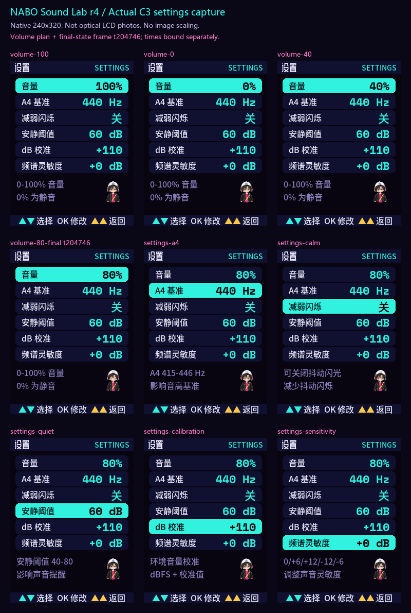

# NABO 声音实验室

戴上耳机，和 NABO 一起玩音乐。用于 FoloToy AI Passport 工牌的独立离线固件，ESP32-C3 / 8MB Flash / 240×320 / ES8311。

**首次公开发布：v0.1.2，实机修订 r4。** 已有验证范围和已知问题公开列出；固件不需要 Wi-Fi，也不包含小智聊天功能。

[下载固件](https://github.com/Liutupi/nabo-sound-lab/releases/tag/v0.1.2) · [刷机说明](docs/FLASHING.md) · [实测与已知问题](docs/VALIDATION_v0.1.2.md) · [构建说明](docs/BUILD.md)

## 可以玩什么

| 分组 | 内容 |
|---|---|
| 玩声音 | 12种变声复读、喊叫跑酷、吹蜡烛、长音走钢丝、声部卡、哼歌飞行、拍手节奏、采样琴 |
| 看声音 | 频谱仪、声纹瀑布、示波器、和弦环、分贝计 |
| 练音乐 | 调音器、吉他工具箱、节拍检测、音准曲线 |
| 设置 | 音量、A4基准、减弱闪烁、安静阈值、dB校准、频谱灵敏度 |

首页使用与 NABO 赛博算命机相同的“阳光小男孩”音色，说“那波，陪你玩音乐！”。音量0–100%，每档10%，0%静音，默认80%，自动保存。▲▼选择，OK操作，双击▲返回；每页底栏显示当前玩法操作。采样琴中三键用于弹奏，长按OK采样。

“NABO 音乐人”造型和全部道具沿用项目定稿；主要中文操作提示16px，设置数值22px。约五分钟无操作后休眠，实体OK唤醒。

## 固件下载与安装

首次安装下载 **nabo-soundlab-0.1.2-merged.bin**，从0x0写入，选择ESP32-C3和8MB Flash。此安装会替换原有玩法，先自行备份。已有相同分区的声音实验室0.1.1/0.1.2，按刷机说明只升级app和assets以保留设置。不要把其他玩法的分区地址直接套用到本项目。

Release 同时提供完整ZIP、分立镜像、manifest.json和SHA256SUMS.txt。发布的是已验证的冻结二进制，未为发布重新编译。当前实物验证覆盖r4 app和assets；实物保留旧boot，完整包包含匹配构建输出的新boot，未另做整包首次安装的端到端实测。

## 实测范围

0/40/80%经三次受控芯片重启后读取一致；12种变声录放完成，音频API读写错误0；首录处理峰值0.680ms。四个正式性能窗口30.30FPS、慢帧0；实际变声演出仍有慢帧。

仍开放：含噪440Hz输入曾误判为约147Hz；旧修订出现过一次无人操作异常返回/重启，原因未定位，后续观察未复现；新版变声是否还存在爆破声，尚待实物听感确认。本固件不作专业调音或声级测量精度承诺。详情及数据边界见[验证记录](docs/VALIDATION_v0.1.2.md)。

以上为C3实际送屏缓冲，原尺寸240×320，非实物面板光学照片；总览底色#0A0716，各帧采集时点不同。

## 源码结构

| 目录 | 内容 |
|---|---|
| firmware/ | 应用、BSP、配置、已冻结素材包 |
| prototype/ | 浏览器原型；新增硬件音量设置尚未同步到原型 |
| game-art/soundlab/ | 定稿造型、道具、起始图、38段源视频、运行时精灵及字体 |
| tools/、tests/ | 素材工具和宿主测试源码 |
| docs/ | 刷机、构建、实测、发布说明与原尺寸截图 |

本机设备备份、NVS、环境录音、原始设备日志、生成服务任务元数据和缓存未上传。源码MIT；NABO形象和美术不随MIT授权，见[NOTICE](NOTICE.md)及[第三方说明](THIRD_PARTY_NOTICES.md)。本项目与FoloToy官方无关联。
