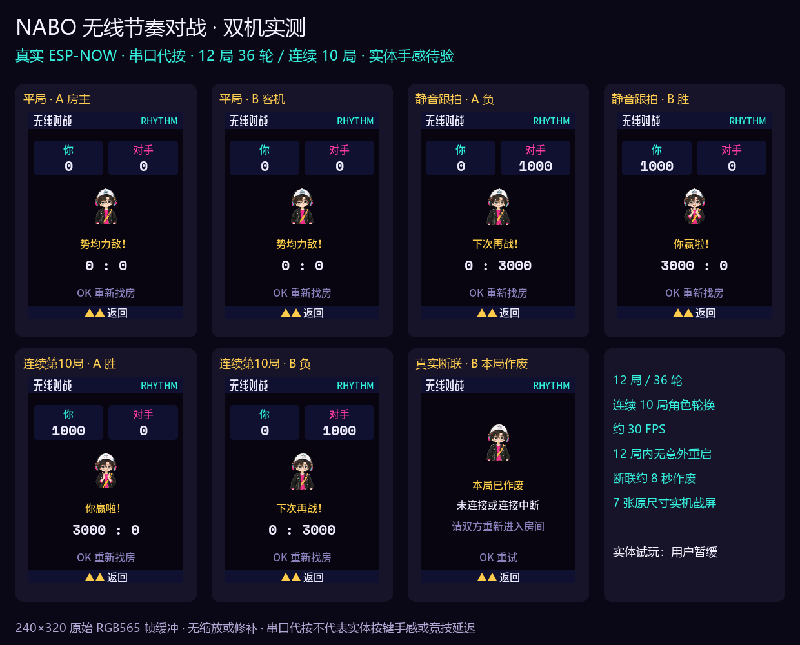

# v0.2.0-preview.1 · 两块工牌，一起跟 NABO 比节奏

把两块 AI Passport 放在一起，进入「玩 → 无线对战」，创建同号房间，接受对手，准备开打。四拍预备后看拍点按 OK，三轮从 90 BPM 加速到 120 BPM，比节奏与稳定度。无需路由器、互联网或账号，也不需要唱歌、辨音高或绝对音感；关闭音效仍能看画面跟拍。

房主明确接受申请后才建立对局。每轮确认双方成绩再继续，重复或旧成绩不会加分；断联约八秒本局作废，不把突然掉线判作自动获胜。两块须使用同一协议版本。

沿用已定稿的 NABO 音乐人、道具和动作。准备、打拍、赢、平、输分别绑定既有演出，主要中文16px、分数22px。修复退出无线后内存碎片导致120px NABO大图不显示的问题，并检查三人合唱画面；原角色、道具和开机语音像素/音频内容保持。

## 已验证与待验证

- A/B两块真实ESP32-C3，冻结应用及素材完成全片回读。另一块从Muse迁移时使用配套boot和分区表。
- 12局36轮真实ESP-NOW受控测试，含连续10局、双方轮换房主、静音客机三轮各1000分，以及双方赢/输/平结算。
- 72个设备轮性能窗口约30.3FPS，最大渲染27ms，无超过33ms的帧、音频读写错误或意外重启；正常对局未观察到RF drop/fail。
- 主动让一端进入ROM停止无线，另一端从复位命令起约8.281秒正确作废；恢复启动后设置一致。该计划重启及预期发送失败不混入正常对局统计。
- 宿主规则、协议故障和字体/动作渲染回归通过；旧玩法11613帧在三种分配条件下逐像素一致。

这是 **GitHub 预览固件**。测试按键由串口受控输入；用户暂缓实体试玩，实体手感、音效与画面时序、实际距离仍待验。内部版本保留 **0.2.0-dev**，二进制与已测版本逐 byte 一致，没有为变更版本号重新编译。

合并镜像已核对全部组件和空白填充，未作为单个完整文件写入实物；B验证的是分立组件迁移。既有含噪440Hz可能出现子谐波、历史无人操作复位原因及变声爆音主观听感未关闭。本固件不作专业测量或竞技延迟精度承诺。

## 下载与安装

[预览固件与完整ZIP](https://github.com/Liutupi/nabo-sound-lab/releases/tag/v0.2.0-preview.1) · [安装说明](FLASHING_0_2_0_PREVIEW.md) · [完整开发验收](VALIDATION_0_2_0_DEV.json)

先核对 SHA256SUMS.txt。已有同布局声音实验室升级 app 与 assets 以保留设置；从其他玩法安装需完整备份后使用本版完整布局。不要混用各版本镜像或直接套用 Muse/小智分区。

应用SHA256：`5d8440c6494d2464b379c49f0af31e12e658e4e2c80ace6e058325c1308c4d24`；素材SHA256：`5fc895c4ef5ef14a0aa90f40ca027d75806c40f4e7a44860f8538d1d5fa61edb`。app分区余量1199104B，assets余量4394052B。其余镜像、源码提交和每个附件的校验值见Release manifest。

原稳定版[v0.1.2](https://github.com/Liutupi/nabo-sound-lab/releases/tag/v0.1.2)保持可用。NABO形象和美术不随源码MIT授权，见NOTICE及THIRD_PARTY_NOTICES。本项目与FoloToy官方无关联。
