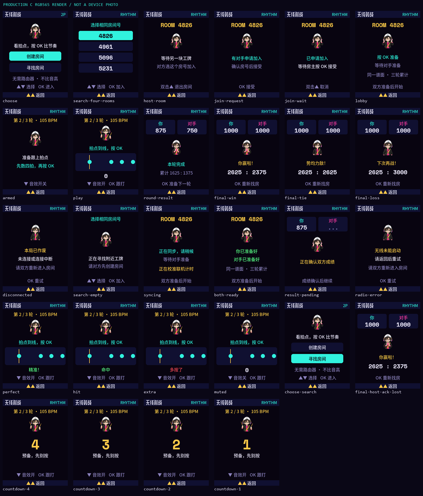
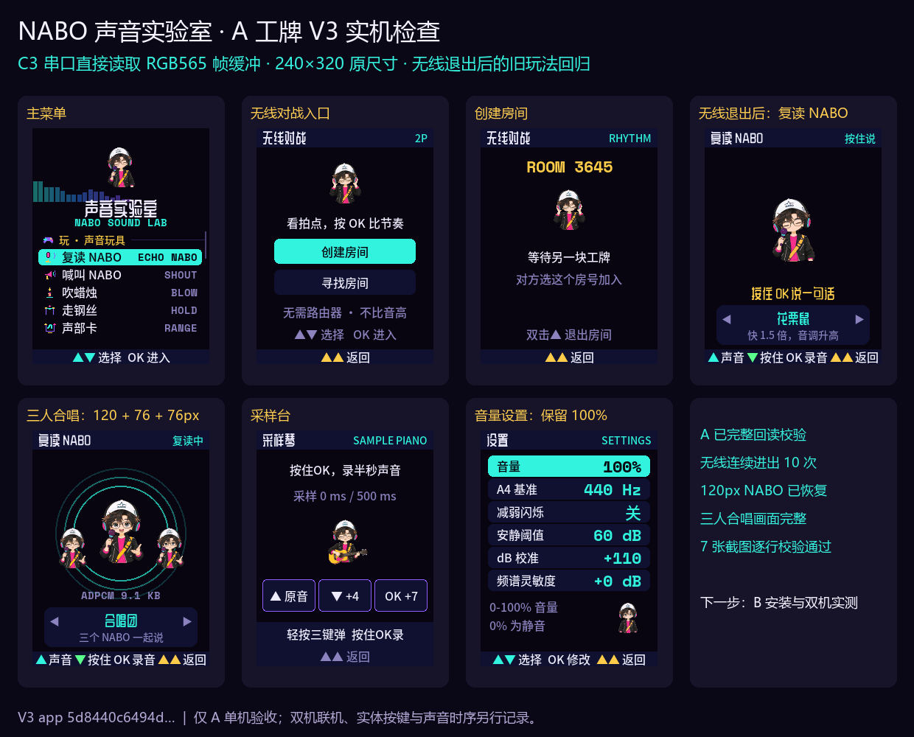

# 无线节奏对战 · 0.2.0 开发规格

两块 AI Passport，进入「玩 → 无线对战」。一人创建房间，另一人选择屏幕上相同的四位房间号加入；房主按 OK 接受申请，双方再按 OK 准备。使用 ESP-NOW 信道 6，不需要路由器、账号或互联网。必须安装相同协议版本。

## 玩家实际做什么

**看拍点，按 OK 比节奏。** 不唱歌、不辨音高，不需要绝对音感。屏幕上的拍点按同一谱面亮起；声音只是辅助。关闭声音仍能按画面完成。两边先有四拍预备，再跟打八拍的谱面；三轮速度为 90 / 105 / 120 BPM，后两轮加入半拍。每轮结束可查看双方分数，双方按 OK 后继续。三轮累计较高者获胜，同分平局。

每个目标拍只记一次：误差 ≤60ms 得100分，≤120ms得60分，≤180ms得20分，其余漏拍0分；多按一次扣20分，分数最低0。每轮按目标数量归一到1000分，三轮最高3000分。长按不自动连打。以按下事件的单调时钟时间判定，不把无线到包时间当作按键时间。按键扫描/屏幕/音频输出延迟仍须两机实测校准；开发版不声称已满足竞技计时精度。

同一房间由房主发随机种子，mulberry32生成相同谱面。互发NTP式四时间戳探测，选择最低往返时延的样本；往返时延须≤80ms且至少3次有效探测，才能准备。开始时间安排在房主时钟约2.5秒后，重复发送、确认，倒计时前确认不齐则作废。所有结果绑定房间会话和轮次，重复/旧包不得加分或开启新局；丢包重试，连续8秒无有效对手消息则本局作废，不自动判对方输。退出发送离开，返回菜单后关闭并释放无线驱动。找房间60秒没有操作则自动停止搜索。

## 画面及演出

240×320，底色#0A0716。主要中文16px，分数22px，主提示19px；不为多塞内容缩字号。房号和玩家状态并列分区。节奏轨道给出前后拍位置和当前判定线，NABO复用S-DRUM；准备复用S-HEADPHONE，赢/平/输分别S-CHEER / S-NOD / S-OOPS。不镜像角色、不生成新角色。每次状态切换显式选择动作。双击▲随时退出并作废本局。

## 实现边界与验收

- 原型：prototype/wireless-duel.html；规则标准：prototype/duel-rules.js。纯C规则、收发状态机与平台驱动分层。无线回调仅复制固定长度包到有界队列，UI线程处理状态。
- 无线只在对战入口内开启；不关联AP，不保存Wi-Fi凭据，不上传麦克风录音，不修改旧NVS结构。保留原17个单人入口及音量设置。
- 固定长度协议、版本/长度/校验/对端MAC/会话/轮次验证；无线失败须返回明确提示，不重启、不擦NVS。
- 独立0.2.0开发构建目录。已发布v0.1.2及其镜像、tag、社区提交不改。app分区0x10000/0x1F0000，assets0x200000/0x600000，保持布局。
- 宿主验证：同种子JS/C逐拍一致；丢包/重复/乱序/错房/旧成绩/离开/断线/重赛；真实C渲染增量与整屏一致、字体齐全、无重叠；ESP32-C3构建与空间检查。
- **双工牌未实测即不发布为已支持联机的正式固件。** 必须补两机找房/确认/连续10局/距离掉线/退出资源回收/声音静音/实体键时序和FPS、heap、largest验证，并绑定最终镜像SHA。

ESP-IDF 5.5.3 API依据：https://docs.espressif.com/projects/esp-idf/en/v5.5.3/esp32c3/api-reference/network/esp_now.html

## 本机复现

使用原构建依赖，运行 `firmware/tools/build-duel.ps1 -Action all`。该入口显式开启无线，独立输出到`firmware/build-duel/`，开发配置为`sdkconfig.duel`，版本0.2.0-dev。普通build.ps1不启用无线菜单。Flash分区保持不变；升级现有兼容布局只写应用和新素材，先完整备份并验证实际设备MAC/Flash容量/分区，再完整回读验证非目标区域保留。新版本素材只扩充字体，所有已有NABO动画、道具和开机录音应逐byte保持。

宿主检查分别运行tests/duel_host/test_rules.py、test_network.py、radio_fault_test.py、test_ui.py。需要宿主C编译器（TCC或相容编译器）、Node、Python/Pillow/NumPy，测试路径仍可用现有项目开发环境调整。网络队列仿真和假SDK故障注入不能替代真实RF测试。

一块刷完可拔下USB后使用电池运行，再刷另一块。固件须相同协议版本；刷写过程中不要换线或按键。两块均完成回读后，一块创建房间，另一块寻找同号房间，房主接受，双方准备。即时退出的离开包为尽力发送；若在关闭驱动前丢失，另一方最迟8秒进入作废页。

2026-10-24的V3已在A单机验证无线初始化与连续10次进出，并复测退出后的复读NABO、三人合唱、采样台和音量设置。旧玩法精灵缓存增加按行分两段的分配回退，解决实际C3退出Wi-Fi后最大连续块不足14400B而丢失120px角色的问题；所有原图像像素保持。下图为A通过串口直接读出的7张完整RGB565帧缓冲总览，双机RF与实体时序验收另记于开发验证JSON。

同日双机实测完成12局36轮，包含连续10局及轮换房主；静音局客机三轮均1000分，双方最终胜负和累计成绩一致。72个设备轮窗口约30.3FPS、最大渲染27ms、无慢帧和音频读写错误。主动让A进入ROM停止无线后，B在命令起约8.281秒检出作废，没有误判胜利。测试通过两块真实C3与真实ESP-NOW完成，按键由串口受控输入；实体手感、视听同步和距离测试不由这些结果替代。用户暂缓实体试玩，0.2.0仍为开发版。

