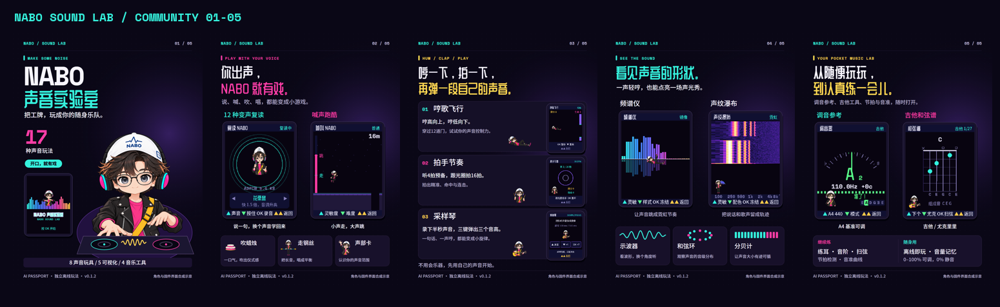

# NABO 声音实验室 · 社区展示材料

主题：**把工牌，玩成你的随身乐队。**

2026-10-23已提交AI Passport玩法社区，项目1538，状态“审核中”。这表示提交成功，尚未公开上架；最终状态以创作者中心为准。[创作者工作台](https://ai-passport.folotoy.cn/account/?project=1538)。

五张1080×1440 PNG按3:4制作，第一张为封面；底色#0A0716。以定稿NABO音乐人和固件界面为基础，文字使用项目字体精确排版。图片属于角色及界面合成示意，不是设备照片。网站保存后解码尺寸900×1200，比例保持3:4。

| 顺序 | 图片 | 重点 |
|---|---|---|
| 1 | [封面](01-cover.png) | NABO音乐人、17种声音玩法、8/5/4功能分组 |
| 2 | [声音玩具](02-voice-toys.png) | 12种变声、声音跑酷、吹蜡烛、走钢丝、声部卡 |
| 3 | [哼拍弹](03-hum-clap-sample.png) | 哼歌飞行、拍手节奏、半秒采样琴 |
| 4 | [看声音](04-see-sound.png) | 频谱、声纹瀑布、示波器、和弦环、分贝计 |
| 5 | [音乐工具](05-music-tools.png) | 调音参考、吉他/尤克里里、练耳/音阶/节拍、音量记忆 |

[完整中文介绍与使用方法](COPY_ZH.md) · [中英文表单文案](listing-content.json) · [图像验证](image-validation.json)

上传完整固件为首版冻结镜像nabo-soundlab-0.1.2-merged.bin，社区回下载3979780字节、SHA256与GitHub原件完全一致。没有为社区重新编译。已知音高/历史复位/变声听感及首次整包安装验证范围随使用说明公开。素材许可仍依根目录NOTICE。
